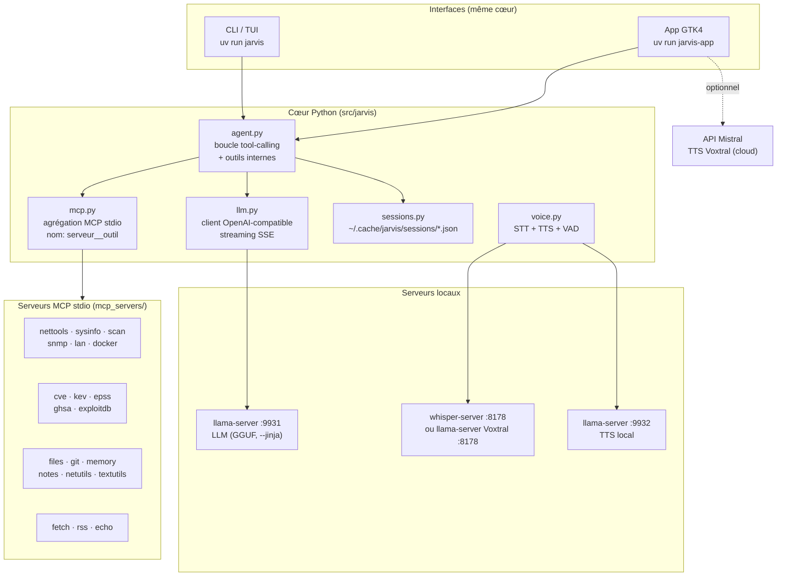

# Jarvis — vue d'ensemble

**Jarvis** est un assistant personnel **100 % local** : un LLM auto-hébergé servi par `llama-server` (llama.cpp, backend Vulkan), piloté par une boucle d'agent en Python qui lui expose des **outils via MCP** (Model Context Protocol), avec en plus une **voix locale** (STT whisper.cpp / Voxtral Realtime, TTS llama.cpp) et une **TTS cloud optionnelle** via l'API Mistral (Voxtral).

Trois interfaces partagent exactement le même cœur (LLM + MCP + voix + sessions) :

| Commande | Interface | Usage |
|----------|-----------|-------|
| `uv run jarvis` | **CLI / TUI** (terminal, `rich` + `prompt_toolkit`) | REPL interactif, streaming, sessions persistantes |
| `uv run jarvis-app` | **GTK4 / libadwaita** (`jarvis-app`) | Fenêtre native : accueil micro, conversation, réglages |
| `uv run python bench/bench_llm.py` | **Benchmark** | TTFT et tok/s du serveur réel |

## Les trois piliers

### 1. Boucle agent + LLM local

Le cœur est une boucle **tool-calling** : `user → LLM → [tool call → résultat → LLM]* → réponse finale`. Le LLM est servi par `llama-server` (API OpenAI-compatible, lancée avec `--jinja` pour le support natif des tools). Le client (`src/jarvis/llm.py`) parle en **streaming SSE** : le raisonnement du modèle (`delta.reasoning_content`) et la réponse (`delta.content`) arrivent fragment par fragment, et les `tool_calls` fragmentés sont réassemblés par index.

Modèles cibles (GGUF, VRAM partagée sur AMD 890M) :

```sh
# MoE recommandé (3B actifs/token) — port par défaut 9931 depuis llama.cpp v0.7.0
llama-server -m ~/models/Qwen_Qwen3.6-35B-A3B-Q4_K_M.gguf \
  -ngl 99 --jinja -fa on --port 9931 --ctx-size 16384

# Dense (comparaison bench)
llama-server -m Mistral-Small-3.3-24B-Instruct.Q4_K_M.gguf \
  -ngl 99 --jinja -fa on --port 9931 --ctx-size 16384
```

> Sur le Framework 13 (Ryzen AI 9 HX 370, Radeon 890M), la VRAM est de la RAM partagée : régler la **carve-out UMA dans le BIOS** (32 Go recommandés pour un 24B Q4). `-fa on` requiert une valeur explicite depuis llama.cpp v0.7.0.

### 2. Outils MCP

Les capacités de Jarvis viennent de **serveurs MCP stdio** (`mcp_servers/*.py`), agrégés par `src/jarvis/mcp.py` et exposés au LLM sous le nom `"<serveur>__<outil>"` (ex. `cve__search_cve`, `files__read_file`). C'est la **frontière stratégique du projet** : le harnais agent ne connaît que ce contrat, les serveurs évoluent librement derrière — un futur modèle fine-tuné cybersécurité (CyberLLM) se branche ici sans rien réécrire.

Familles de serveurs : diagnostic réseau (`nettools`, `sysinfo`, `scan`, `snmp`, `lan`), fichiers confinés (`files`), utilitaires purs (`netutils`, `textutils`), `git` lecture seule, `docker` lecture seule, mémoire/notes persistantes (`memory`, `notes`), **veille sécurité** (`cve` NVD, `kev` CISA, `epss` FIRST, `ghsa` GitHub, `exploitdb`), web (`fetch`, `rss`), et `echo` pour les tests.

→ Voir [Catalogue des serveurs MCP](./08-mcp-serveurs.md).

### 3. Voix

Deux serveurs **indépendants** du llama-server principal :

- **STT** : `whisper-server` (whisper.cpp, `POST /inference`) ou `llama-server` + modèle audio Voxtral Mini 4B Realtime (`POST /v1/audio/transcriptions`, avec fallback chat multimodal puis websocket `GET /v1/realtime?intent=transcription` — seul chemin supporté par les modèles ASR streaming). Enregistrement micro avec **VAD** (détection de fin de parole par seuil RMS, plafond 60 s).
- **TTS local** : `llama-server` + modèle de synthèse (ex. Voxtral 4B TTS), `POST /v1/audio/speech` avec fallback `POST /tts`.
- **TTS cloud (secours ou choix)** : API Mistral `POST /v1/audio/speech` (modèles `voxtral-*-tts`), avec **émotions inline** Voxtral TTS 3 (`[emotion=..][pace=..]` posés par le LLM en tête de réponse, envoyés au TTS uniquement, jamais affichés) et **fallback automatique** sur le TTS local si l'API échoue.

→ Voir [Voix locale (STT/TTS)](./11-voix-locale.md) et [TTS API Mistral](./12-tts-api-mistral.md).

## Schéma d'ensemble



## Phases du projet

1. **Boucle agent CLI** : chat REPL + tool calling sur MCP, LLM via `llama-server` — ✅ en place.
2. **Outils** : serveurs MCP dédiés (diag réseau, CVE, exec shell restreint…) — ✅ en place.
3. **Voix** : STT local + TTS local — ✅ en place. Barge-in / full-duplex (micro permanent VAD → agent) : à évaluer (Pipecat), **pas avant**.

## Structure du dépôt

```
src/jarvis/
  config.py    # chargement TOML ([llm], [agent], [voice.stt], [voice.tts], [voice.tts_api], [mcp.servers.*])
  llm.py       # client OpenAI-compatible (llama-server), streaming SSE + tools
  mcp.py       # agrégation de MCP servers stdio -> schémas outils "<serveur>__<outil>"
  agent.py     # boucle tool-calling (streaming, hooks d'affichage, outils internes)
  compact.py   # compactage de l'historique (commande /compact + outil interne jarvis__compact)
  tts_tags.py  # tags inline [emotion=..][pace=..] Voxtral TTS 3 (extraction / strip)
  voice_tone.py# outil interne jarvis__voice_tone (le LLM fixe le ton de la voix)
  voice.py     # clients STT (whisper/voxtral, cascade batch -> chat -> WS realtime) et TTS,
               # gestion des processus serveurs voix, record/play WAV, VAD
  mistral_tts.py # client API Mistral (POST /v1/audio/speech, GET /v1/models, /v1/audio/voices)
  server.py    # statut + start/stop du llama-server (GET /v1/models, Popen, garde loopback)
  models.py    # découverte des GGUF locaux (~/models, cache HF, $JARVIS_MODEL_DIRS), classés LLM/TTS/STT
  gpu.py       # détection GPU (NVIDIA/AMD ROCm/Vulkan/lspci) + choix persistant (gpu.json)
  sessions.py  # sessions persistantes ~/.cache/jarvis/sessions/<id>.json (écriture atomique)
  netguard.py  # garde SSRF partagée (loopback/link-local/privé refusés)
  ttyguard.py  # snapshot/restauration termios à la sortie (atexit + SIGTERM/SIGINT)
  tui.py       # affichage rich : panneau thinking repliable, réponse Markdown live, statut outils
  cli.py       # REPL (bannière, prompt, commandes /, multiligne, notifications OSC)
  gtk/         # interface GTK4 / libadwaita : app.py, backend.py (asyncio + queue),
               # widgets.py, markdown.py (CommonMark+GFM -> widgets GTK natifs)
mcp_servers/   # 19 serveurs MCP stdio (voir catalogue)
bench/         # bench_llm.py : TTFT / tok/s en streaming (sépare raisonnement et contenu)
tests/         # mock LLM (SSE + tool_calls fragmentés), tests end-to-end, tests MCP, GTK…
```

## Repères de fichiers d'état

| Chemin | Rôle |
|--------|------|
| `config.toml` (copié de `config.example.toml`) | Configuration principale |
| `~/.config/jarvis/mistral.json` | Clé API Mistral TTS (**chmod 0600**, jamais dans `config.toml`, jamais loguée) |
| `~/.config/jarvis/ui.json` | Préférences UI GTK (thème, micro, TTS on/off, `mic_permission_asked`…) |
| `~/.config/jarvis/gpu.json` | Choix GPU persistant pour les serveurs locaux |
| `~/.cache/jarvis/sessions/` | Sessions de conversation (JSON, une par fichier) |
| `~/.cache/jarvis/history` | Historique des saisies du REPL |
| `~/.cache/jarvis/memory.md` | Mémoire persistante (`memory` MCP, surchargeable via `JARVIS_MEMORY_FILE`) |
| `~/.cache/jarvis/notes/` | Notes par sujet (`notes` MCP, surchargeable via `JARVIS_NOTES_DIR`) |
| `~/.cache/jarvis/jarvis.log` | Log DEBUG complet (la console reste en WARNING sauf `/verbose`) |

→ Suite : [Architecture détaillée](./02-architecture.md)
