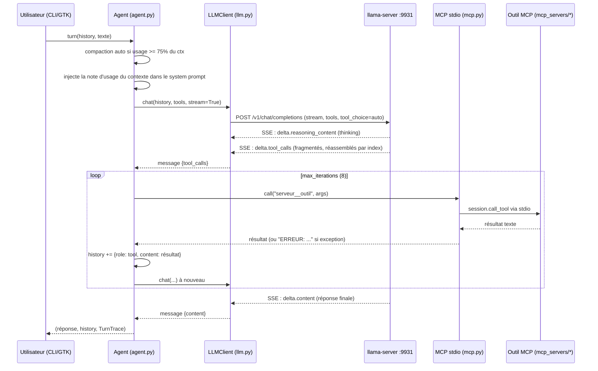

# Architecture détaillée

## Flux d'un tour de conversation



Points clés du flux :

- **Streaming SSE** : `llm.py` lit `data: {...}` ligne par ligne, réassemble les `tool_calls` fragmentés par `index` (`id`/`function.name`/`function.arguments` concaténés), et appelle les callbacks `on_reasoning` / `on_content` à chaque fragment.
- **Robustesse** : si un outil lève une exception (serveur MCP mort, timeout), le tour ne meurt pas — le modèle reçoit `"ERREUR: <Type>: <message>"` comme résultat d'outil et peut réagir. Si le serveur renvoie une erreur de *tool call tronqué* (contexte plein → HTTP 500 « Failed to parse tool call arguments »), l'agent **compacte l'historique et réessaie une fois**.
- **Itérations** : `max_iterations = 8` par défaut (`[agent]`), puis le tour se termine par `(arrêt: trop d'itérations d'outils)`.
- **Trace** : chaque tour retourne un `TurnTrace` (liste des `(outil, args_json)`, nombre d'itérations, erreur éventuelle, `tts_tags` extraits) — utilisé par `/tool N`, `/thinking` et le TTS.

## `agent.py` — la boucle

```python
Agent(llm, tools, system_prompt, max_iterations=8, stream=True,
      internal_tools={"jarvis__compact": ..., "jarvis__voice_tone": ...},
      ctx_max=..., ctx_usage=...)
```

- Si aucun message `system` n'est présent, le `system_prompt` est inséré en tête.
- **Outils internes** (hors MCP) : exposés au modèle comme des outils classiques, avec un schéma `{type: object, properties: {}}` vide :
  - `jarvis__compact` : remplace l'historique par `[system, user(résumé), assistant(accusé)]` (voir [Gestion du contexte](../Noyau/contexte-compactage.md)) ;
  - `jarvis__voice_tone` : enregistre le ton de voix dans `trace.tts_tags` (voir [Émotions TTS](../Voix/emotions-tts.md)).
- **Note d'usage du contexte** : à chaque itération, `[Usage du contexte : ~N/M tokens. Si tu approches de la limite, appelle jarvis__compact...]` est injecté dans le system prompt (en remplaçant la note précédente) pour que le modèle voie combien il lui reste.

## `mcp.py` — agrégation MCP

Chaque serveur de `[mcp.servers.<nom>]` est lancé en **sous-processus stdio** (protocole MCP) via le SDK `mcp` (`StdioServerParameters` + `stdio_client` + `ClientSession`). L'**environnement complet du processus** est transmis (`env={**os.environ}`) pour que les variables des serveurs (`NVD_API_KEY`, `JARVIS_FILES_ROOTS`…) arrivent.

- Les outils sont exposés au LLM sous `"<nom>__<outil>"` pour éviter les collisions.
- `schemas()` produit les schémas OpenAI `tools` (compatible SDK MCP v1 `inputSchema` et v2 `input_schema`).
- `call(full_name, args)` dépile le préfixe, appelle `session.call_tool`, et concatène les blocs texte ; en cas d'erreur MCP, remonte `"ERREUR outil: ..."`.
- L'interface est **stable** : `schemas()` / `names()` / `descriptions()` / `by_server()` / `call()`. C'est tout ce que connaît l'agent.

## `llm.py` — client OpenAI-compatible

Client minimal en `httpx` (pas le SDK OpenAI — le format Mistral tool-calling est fragile à travers les couches d'abstraction) :

- `POST {base_url}/chat/completions` avec `{model, messages, temperature, max_tokens, stream?, tools?, tool_choice: "auto", chat_template_kwargs?}`.
- `chat_template_kwargs` (ex. `{enable_thinking = false}` en TOML) est passé à chaque requête pour couper le thinking des modèles type Qwen3.6 au profit de la latence.
- En non-stream : un POST, `choices[0].message` normalisé (`tool_calls` absent plutôt que `null`).
- En stream : parsing SSE manuel, `LLMError` sur HTTP != 200 ou `chunk.error`.

## `sessions.py` — persistance

Sessions **globales** (pas par dossier) : un fichier JSON par conversation dans `~/.cache/jarvis/sessions/<id>.json` (`id = AAAAMMJJ-HHMMSS-<6 hex>`), contenant `{id, title, updated, messages[]}`.

- **Écriture atomique** : `.json.tmp` puis `replace()`.
- **Hardening** : un `sid` contenant `/`, `\` ou `..` est refusé (path traversal).
- Au démarrage du CLI, la **dernière session est reprise automatiquement** ; `/sessions`, `/load N`, `/new` pour naviguer. La GTK expose la même chose dans sa sidebar.
- Le titre = premier message utilisateur (tronqué à 80 caractères).

## `server.py` — gestion du llama-server

Trois états : `"online"` (serveur externe qui répond), `"managed"` (processus lancé par Jarvis), `"offline"`.

- `get_status()` : `GET /v1/models`, ne lève jamais.
- `start_server(model_path, base_url, extra_args)` : lance `llama-server -m <gguf> --host H --port P -ngl 99 --jinja -fa on --ctx-size 16384` (+ args GPU), attend que `/v1/models` réponde (timeout 120 s), log dans `~/.cache/jarvis/llama-server-gui.log`.
- **Garde-fou loopback** : un host non-loopback est **refusé** (llama-server serait exposé sans clé API, CORS ouvert) sauf `JARVIS_ALLOW_PUBLIC_LLM=1`.
- **Hygiène des logs** : seuls les args et les variables GPU *modifiées* sont journalisés — jamais `os.environ` complet (les clés `NVD_API_KEY`/`GITHUB_TOKEN`/`MISTRAL_API_KEY` n'y finiraient jamais en clair).
- `stop_server()` ne touche qu'au processus **géré** (jamais un serveur externe).

## `models.py` — découverte des GGUF

Scan de `$JARVIS_MODEL_DIRS` + `~/models` + `~/.cache/huggingface/hub` (dédupliqué, `*.gguf` récursif), classé par mode :

1. **répertoire parent** `stt/` ou `tts/` (ex. `~/models/stt/Q4_K_M.gguf`) → mode forcé ;
2. sinon **heuristique de nom** : `whisper`/`ggml-` → STT ; `piper|kokoro|xtts|coqui|vits|melo|tts|voxtral` → TTS ;
3. le reste → LLM.

## `gpu.py` — détection et choix GPU

- `detect_gpus()` : NVIDIA (`nvidia-smi`), AMD ROCm (`rocm-smi`), Vulkan (`vulkaninfo`/`llama-server --list-devices`), fallback `lspci`.
- Le choix de l'utilisateur est persisté dans `~/.config/jarvis/gpu.json` et traduit en :
  - **args** pour Vulkan : `--device <nom ggml>` (ex. `Vulkan1`) — permet de répartir les modèles sur plusieurs GPU ;
  - **env** pour CUDA/HIP/CPU : `CUDA_VISIBLE_DEVICES` / `HIP_VISIBLE_DEVICES` / `ROCR_VISIBLE_DEVICES`.
- `choice_args()` / `choice_env()` sont consommés par `server.py` (LLM) et `voice.py` (STT/TTS) ; chaque serveur voix peut aussi surcharger via `device = "Vulkan1"` et `env = {...}` dans `config.toml`.

## `ttyguard.py` — protection du terminal

`prompt_toolkit` restaure normalement le tty, mais une sortie anormale (exception dans un key binding, crash, SIGTERM, kill) peut laisser le terminal en **mode brut** (plus d'echo). `install()` sauvegarde les termios de stdin à l'entrée et les restaure : à la sortie du process (`atexit`), sur `SIGTERM`/`SIGINT` (re-émis ensuite avec le handler par défaut), et explicitement via `restore_stdin()` dans le `finally` du point d'entrée.

## Cœur partagé, UI découplées

Le CLI (`cli.py` + `tui.py`) et la GTK (`gtk/app.py` + `gtk/backend.py`) instancient **les mêmes objets** (`LLMClient`, `McpToolProvider`, `Agent`, `SessionStore`, fonctions de `voice.py`). Seule la couche d'affichage diffère :

- **CLI** : `rich` — panneau de raisonnement repliable, réponse rendue en Markdown en live (repaint manuel throttlé à ~15 Hz), statut des outils `✓/✗ + durée`.
- **GTK** : `GtkBackend` fait tourner une boucle `asyncio` dans un thread dédié, pousse les événements vers le thread GTK via `GLib.idle_add` (queue), et rend les réponses en **widgets GTK natifs** (parseur CommonMark+GFM maison, `gtk/markdown.py`) — ou en HTML `markdown-it-py` dans une WebView WebKitGTK si `JARVIS_WEBKIT=1` (opt-in, repli automatique sur le rendu natif si WebKit échoue).
